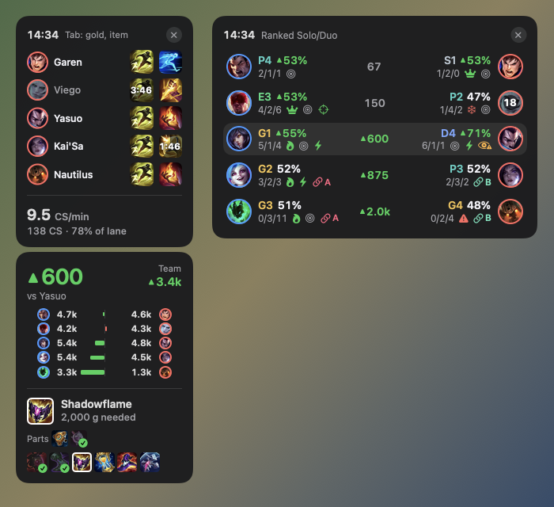
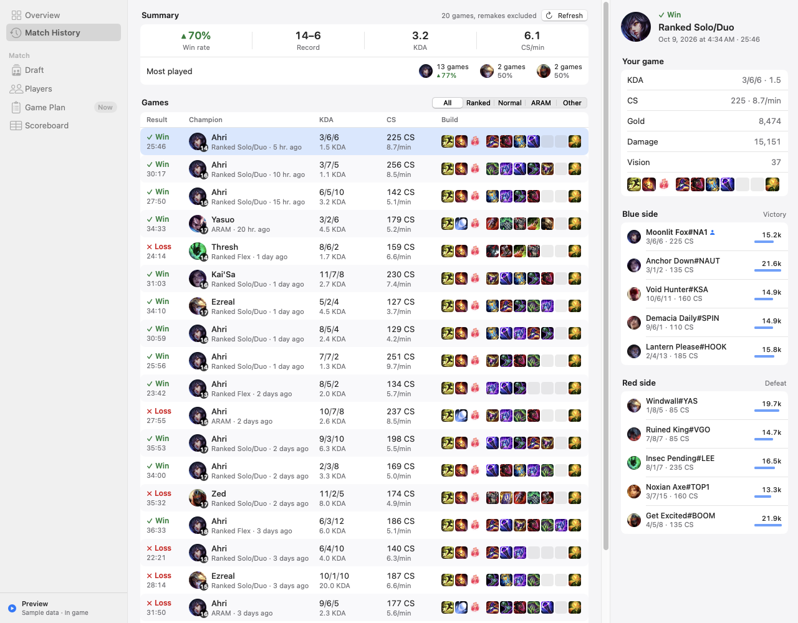
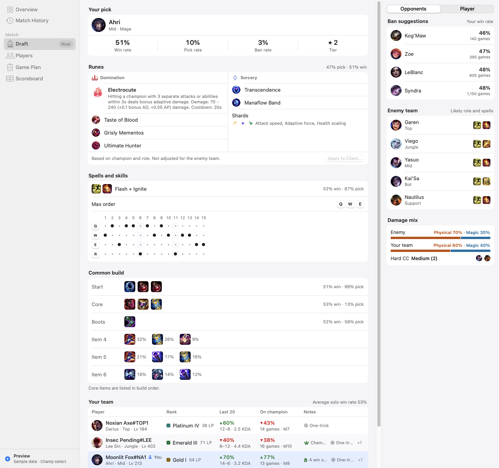
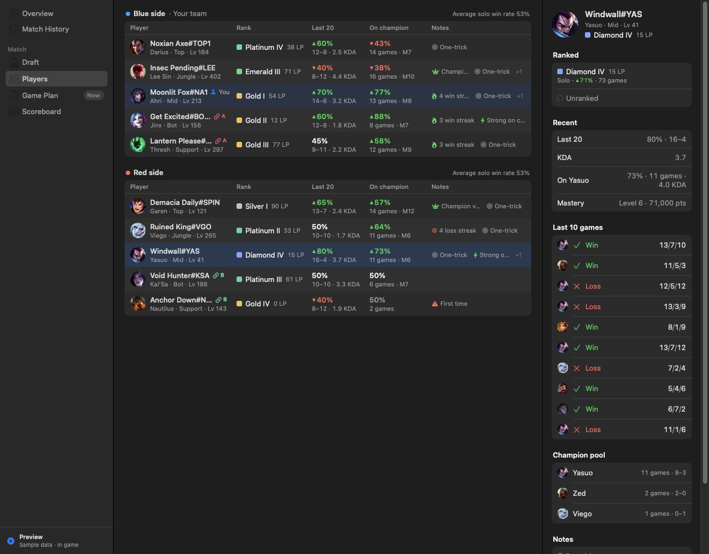
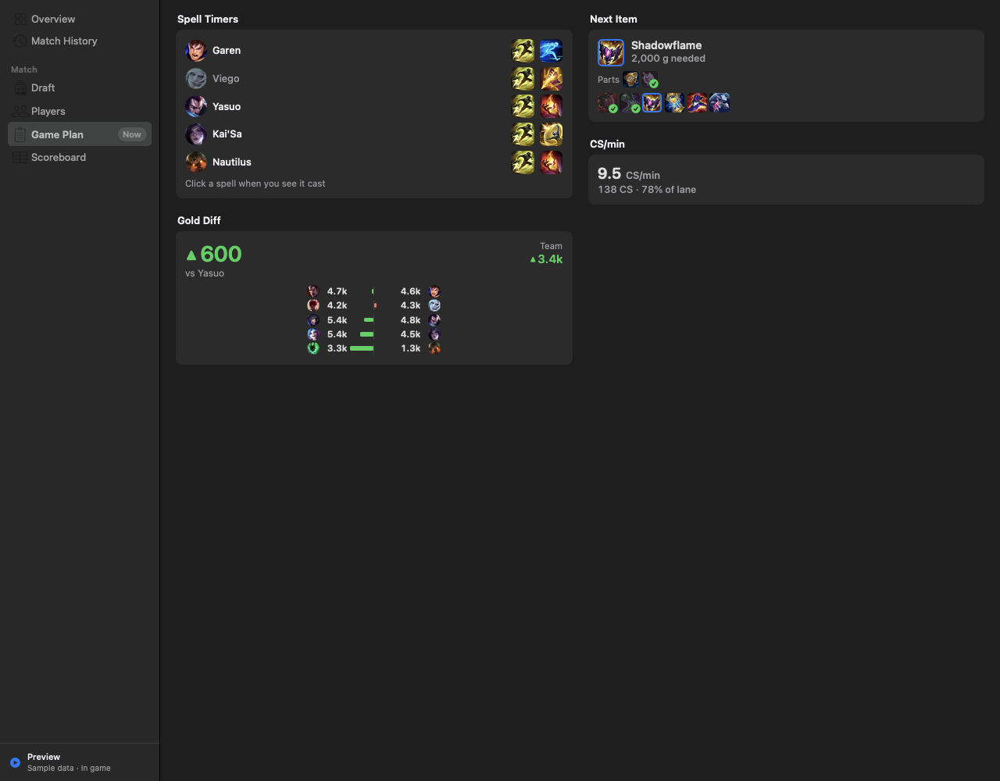
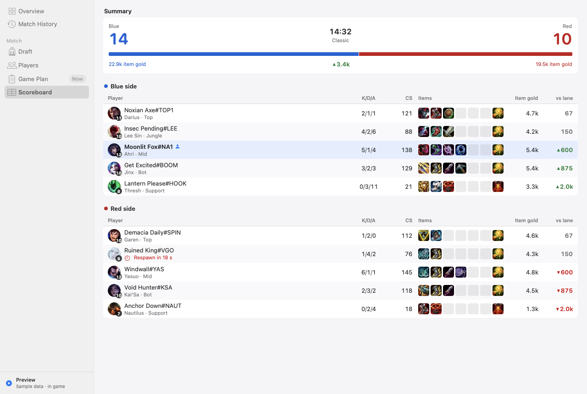
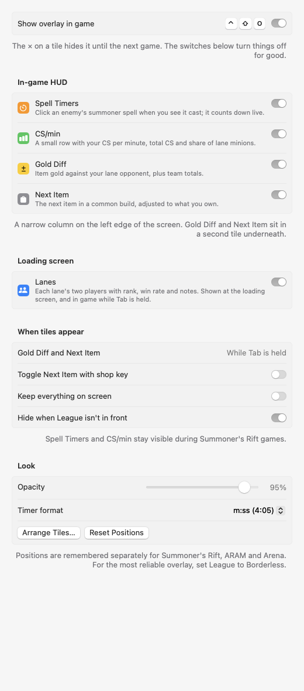

# Sightline

A lightweight, native macOS companion and in-game overlay for League of Legends.

Sightline scouts both teams at the loading screen, times enemy summoner spells, tracks your CS per
minute, gold lead and next item during the game, and shows your match history. It uses the League
client already running on your Mac plus public build data. No account, no API key, no Overwolf.

<p align="center">
  
</p>

- **Native:** Swift and SwiftUI, a ~1.8 MB app that idles at 0% CPU
- **Hands off the game:** only Riot's local APIs (the League client's local API and the official
  Live Client Data API); no code injection, no memory reading, no automation
- **Mac-like:** light and dark appearance, your system accent color, a sidebar, an inspector, ⌘ shortcuts

## Features

### In-game HUD

A narrow column on the left edge of the screen (press ⌃⇧M to drag it somewhere else):

| Section | What it does |
|---|---|
| **Spell Timers** | One row per enemy with their two summoner spells. Click a spell when you see it cast and it greys out and counts down live. Accounts for Ionian Boots; click again to clear. |
| **CS/min** | Your CS per minute and total CS, plus the share of lane minions you've collected if you play top, mid or bot. |
| **Gold Diff** *(hold Tab)* | Item-gold lead over your lane opponent, the team difference, and a per-lane chart. |
| **Next Item** *(hold Tab)* | The next item of a common build for your champion and role, adjusted to what you already own, with the gold you still need. |

Spell Timers and CS/min stay up all game. Gold Diff and Next Item appear in a second tile underneath
while Tab is held, or always if you turn on *Keep everything on screen*. The **×** on the HUD or the
Lanes tile hides it until the next game.

These sections are made for Summoner's Rift. In ARAM, holding Tab shows Gold Diff and Next Item;
Arena gets only the Lanes tile.

### Lanes tile

At the loading screen, the **Lanes** tile shows each lane's two players side by side: rank, season
win rate, notes such as win or loss streaks, first time on a champion or a possible smurf, and
premade groups. In game it comes back while Tab is held.

### Main window

| | |
|---|---|
|  | **Match History.** Your recent games with result, champion, queue, KDA, CS/min, spells, keystone and items. Filter by Ranked, Normal or ARAM, load older games, and select one to see both teams. |
|  | **Draft** (champ select). Spells, skill order and the common build for your pick, a scouting table for your team, and enemy picks as they lock in. On Summoner's Rift you also get the common rune page with a confirmed *Apply to Client*, ban suggestions, and each enemy's likely role and spells. Ranked champ select hides your teammates' names, so they're looked up at the loading screen. |
|  | **Players** (loading screen). Both teams as tables: rank, recent win rate and KDA, stats on their current champion, mastery, recent form and notes. Select a player for their Solo and Flex rank, last 10 games and champion pool. |
|  | **Game Plan.** The HUD's content at a larger size, for a second screen. |
|  | **Scoreboard.** Kills, item gold and every player's items, with each lane's gold difference. |
|  | **Settings.** Turn HUD sections on or off, choose when they appear, opacity, timer format and text size. |

Screenshots use Sightline's sample players with live build data from OP.GG.

## Getting started

Requirements: macOS 14 or later and Xcode 15.3 or later (Swift 5.10+).

```bash
git clone https://github.com/Aye-Shun/sightline.git
cd sightline
./scripts/build-app.sh
open build/Sightline.app
```

`build-app.sh` makes an optimized, ad-hoc signed `build/Sightline.app` that runs on the Mac that
built it. Move it to `/Applications` if you like.

Open Sightline before you play; it lives in the menu bar (binoculars icon), so closing the window
doesn't stop it. Use **Preview** in the toolbar to try every screen and the overlay without a game.

**Overlay tips**
- Set League's window mode to **Borderless** for the most reliable overlay.
- If the HUD doesn't appear in game, turn off *Settings → Overlay → Hide when League isn't in front*.

**Shortcuts**

| Keys | Action |
|---|---|
| Hold Tab | Show Gold Diff, Next Item and the Lanes tile |
| ⌃⇧O | Overlay on or off |
| ⌃⇧M | Arrange (drag) the overlay tiles |
| ⌘1 – ⌘6 | Overview, Match History, Draft, Players, Game Plan, Scoreboard |
| ⌘, | Settings |

## How it works

| Source | Used for |
|---|---|
| League client local API (127.0.0.1) | Your account, champ select, the game's players, ranks, match history and mastery. Found through the client's lockfile, or its process arguments if League is installed outside /Applications. No API key. |
| Live Client Data API (127.0.0.1:2999) | Riot's official in-game API: the clock, scores, items and summoner spells. |
| [OP.GG](https://op.gg) public API | Common runes, builds, skill orders, counters and synergies. Only champion names, roles and the game mode are sent. Cached for 6 hours. |
| [Data Dragon](https://developer.riotgames.com/docs/lol#data-dragon) | Champion, item, rune and summoner spell data and icons. |
| [CommunityDragon](https://communitydragon.org) | Icons for rune stat shards, which Data Dragon doesn't include. |

The only change Sightline makes to the client is creating (or replacing) its own
"Sightline: *champion*" rune page, and only after you confirm it. It never sends your client
credentials anywhere, and there are no accounts or analytics.

**Lightweight:** with League in /Applications, finding the client is just a file check; polling
slows to every 3–4 seconds outside ready checks, champ select and games; the Tab-key check runs only
during games; overlay windows are released after each game; and build data is cached on disk.

## Development

```bash
swift run Sightline --demo                                # launch straight into preview data
swift run Sightline --snapshot /tmp/draft.png --scene draft --appearance light
```

Snapshot scenes: `overview`, `history`, `draft`, `players`, `players-inspector`, `plan`,
`scoreboard`, `settings`, `overlays`. These render offscreen, without opening any windows.
Diagnostic scenes `window-sizing`, `tab-stress` and `timer-test` print checks for overlay sizing and
the spell timers.

```
Sources/Sightline/
  App/          entry point, menu bar, settings model, snapshot renderer
  LCU/          League client discovery, REST client, models, rune page writer
  LiveClient/   in-game Live Client Data API
  Data/         Data Dragon static data, image cache
  Meta/         OP.GG client, popular data, game modes, team composition,
                build progress, spell timers, farm benchmark
  Model/        player profiles, stats, tags, premades, match history
  Services/     GameMonitor (polling and state), profile loader, match history store
  Overlay/      overlay windows, hotkeys, HUD and Lanes tiles
  Views/        main window screens and design system
  Demo/         preview data
```

## License

[MIT](LICENSE)

## Disclaimer

Sightline isn't endorsed by Riot Games and doesn't reflect the views or opinions of Riot Games or
anyone officially involved in producing or managing Riot Games properties. Riot Games, and all
associated properties are trademarks or registered trademarks of Riot Games, Inc.

Sightline is not affiliated with OP.GG or CommunityDragon. The League client's local API isn't
officially supported by Riot for third-party apps, so use Sightline at your own risk and check Riot's
current policies.
